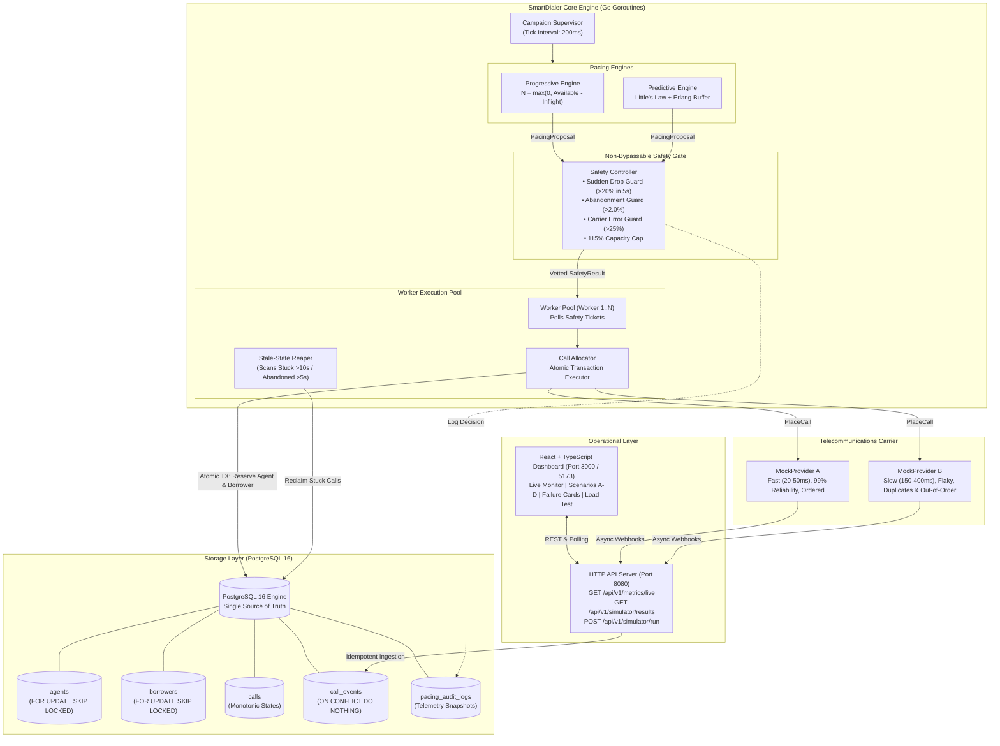
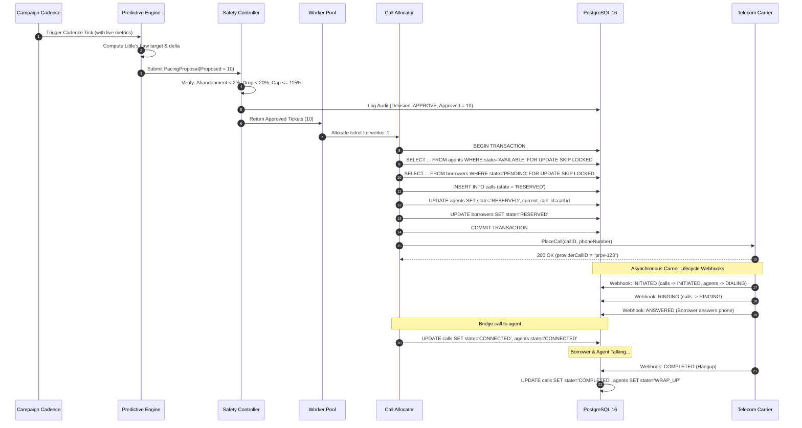
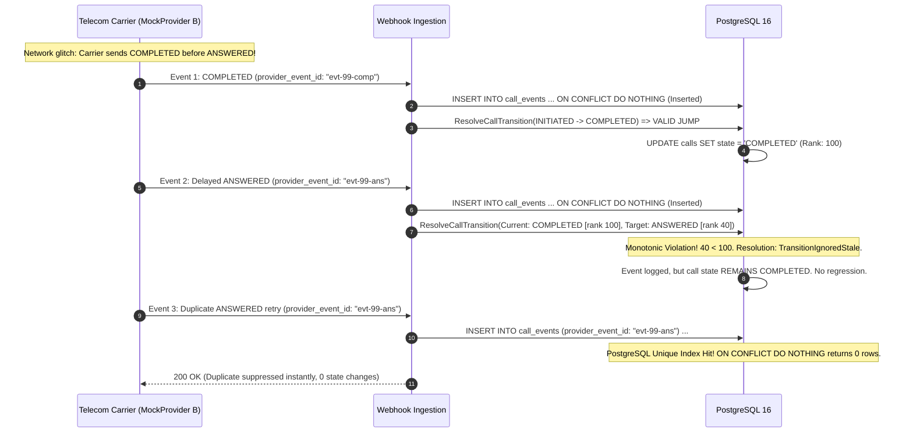
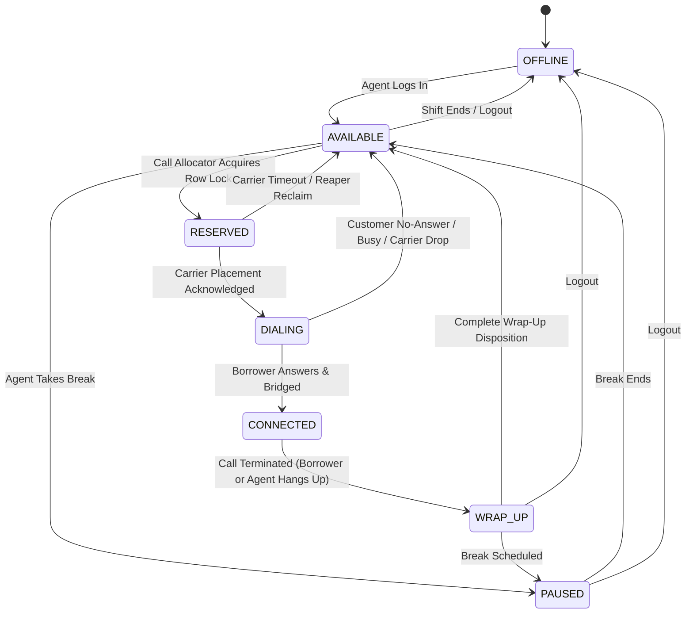

# SmartDialer: End-to-End System Design, HLD/LLD & Architecture Guide

This document is the definitive technical manual for **SmartDialer**, explaining what problem it solves, how the distributed system works end-to-end, the exact High-Level Design (HLD) and Low-Level Design (LLD) concepts applied, what the performance metrics represent, and the critical system design questions that arise from this architecture.

---

## Table of Contents
1. [The Core Problem: Why SmartDialer Exists](#1-the-core-problem-why-smartdialer-exists)
2. [High-Level Design (HLD) & Core Philosophy](#2-high-level-design-hld--core-philosophy)
3. [End-to-End System Architecture Diagram](#3-end-to-end-system-architecture-diagram)
4. [Data Flow & Sequence Diagrams](#4-data-flow--sequence-diagrams)
5. [Low-Level Design (LLD) & State Machines](#5-low-level-design-lld--state-machines)
6. [System Design & Distributed Systems Concepts Used](#6-system-design--distributed-systems-concepts-used)
7. [Mathematical Pacing Models](#7-mathematical-pacing-models)
8. [Understanding the Metrics: Scenarios, Failures & Load Test](#8-understanding-the-metrics-scenarios-failures--load-test)
9. [Scale Analysis (100 -> 1,000 -> 10,000 -> 100,000 Agents)](#9-scale-analysis-100---1000---10000---100000-agents)
10. [Top System Design & Technical Interview Questions & Answers](#10-top-system-design--technical-interview-questions--answers)
11. [Enterprise Robustness Modules & Deep-Dive Documents](#11-enterprise-robustness-modules--deep-dive-documents)

---

## 1. The Core Problem: Why SmartDialer Exists

In outbound debt collections and call centers, human agents are the single most expensive operational cost. However, customer answer rates across telecom carriers are notoriously low (typically **15% to 35%**).

If an agent has to manually dial each number or wait for the phone to ring, the agent spends **70% to 80% of their shift listening to ringing tones, voicemails, or busy signals**. This results in abysmal productivity.

### The Conflict: Progressive vs. Predictive Dialing

To solve this, call centers use automated dialers, but they face a fundamental trade-off:

```
[ Progressive Dialing ]                              [ Predictive Dialing ]
- Dials strictly 1:1 per available agent.            - Over-dials aggressively based on statistical math.
- Advantage: 0% Abandoned Calls (100% compliant).    - Advantage: High agent utilization (60% to 85%+).
- Disadvantage: Low agent utilization (30% to 50%).   - Danger: If too many people answer, calls get abandoned!
```

### The Regulatory Danger: Call Abandonment
If a predictive dialer dials 50 calls for 10 agents, and 15 borrowers answer simultaneously:
- 10 borrowers are connected to the 10 available agents.
- **5 borrowers hear silence or a dead line because no agent is free.**
- In telecommunications law (e.g., US FTC/FCC, UK Ofcom), this is classified as an **Abandoned Call**.
- Regulatory bodies impose severe penalties (up to **$50,000+ per violation**) if a call center's rolling abandonment rate exceeds **3.0%** (or **2.0%** in stricter jurisdictions).

### What SmartDialer Solves
SmartDialer solves this classic dilemma by uniting **Predictive Pacing** (maximizing agent talk time) with a strict, non-bypassable **Safety Controller** (enforcing progressive fallback the instant abandonment risks or carrier shocks occur), backed by an atomic, zero-bloat PostgreSQL transaction engine.

---

## 2. High-Level Design (HLD) & Core Philosophy

### Zero-Bloat Principle (No Kafka, No Redis, No Distributed Lock Managers)
Most modern architectures prematurely introduce Kafka, Redis Redlock, and microservices. In an outbound dialer, this creates fatal split-brain states:
- If Redis grants an agent lock, but the worker crashes before Kafka publishes the dial event, the agent is stuck in limbo.
- Two workers reading stale cache keys in Redis can double-allocate the same debtor or agent.

**SmartDialer uses PostgreSQL 16 as the Single Source of Truth (SSOT):**
1. Atomic multi-resource locking using `SELECT ... FOR UPDATE SKIP LOCKED`.
2. Idempotent webhook logging via `INSERT INTO call_events ... ON CONFLICT DO NOTHING`.
3. Out-of-order webhook reconciliation using monotonic state machine ranks.
4. Self-healing via an asynchronous Stale-State Reaper.

### Strict Architectural Pipeline
The code guarantees by interface boundaries that pacing math can **never** dispatch calls directly:
$$\text{Campaign} \longrightarrow \text{Pacing Engine} \longrightarrow \text{Safety Controller} \longrightarrow \text{Call Allocator} \longrightarrow \text{Telecom Provider}$$

---

## 3. End-to-End System Architecture Diagram



---

## 4. Data Flow & Sequence Diagrams

### 4.1 Normal End-to-End Call Flow
The following sequence diagram illustrates what happens from the moment an agent becomes available to call completion:



### 4.2 Failure Flow: Worker Crash & Reaper Self-Healing
If a worker crashes mid-call setup, the system self-heals without manual intervention:

```mermaid
sequenceDiagram
    autonumber
    participant W as Worker
    participant DB as PostgreSQL 16
    participant R as Stale-State Reaper
    participant A as Agent
    participant B as Borrower

    W->>DB: Atomically reserve Agent & Borrower (State = RESERVED)
    Note over W: Worker process CRASHES (SIGKILL / OOM / Network severed)
    Note over DB: Agent & Borrower remain stuck in RESERVED. No webhooks arrive.
    
    loop Every 1 Second
        R->>DB: SELECT ... FROM calls WHERE state IN ('RESERVED', 'INITIATED') AND updated_at <= NOW() - 10s
        DB-->>R: Returns stuck call caad3762 (Age: 15 seconds)
        R->>DB: BEGIN TRANSACTION
        R->>DB: UPDATE calls SET state = 'FAILED', updated_at = NOW()
        R->>DB: UPDATE agents SET state = 'AVAILABLE', current_call_id = NULL
        R->>DB: UPDATE borrowers SET retry_count = retry_count + 1, state = 'PENDING', next_retry_at = NOW() + 10s
        R->>DB: COMMIT TRANSACTION
        Note over R: Agent is safely released back to work; Borrower rescheduled with backoff.
    end
```

### 4.3 Resilience Flow: Duplicate & Out-Of-Order Webhooks
Telecom networks (especially SIP trunks and cellular carriers) frequently send duplicate or out-of-order UDP/HTTP callbacks:



---

## 5. Low-Level Design (LLD) & State Machines

### 5.1 Agent State Machine
Agents represent call center representatives handling collections accounts.



### 5.2 Call State Machine & Monotonic Ranks
To ensure deterministic safety, every `CallState` is assigned an immutable numerical rank:

| State | Monotonic Rank | Terminal? | Description |
|---|:---:|:---:|---|
| `QUEUED` | 0 | No | Borrower lead queued in dialer backlog. |
| `RESERVED` | 10 | No | Agent and Borrower locked; call row created. |
| `INITIATED` | 20 | No | Telecom carrier accepted dial request. |
| `RINGING` | 30 | No | Borrower's device is actively ringing (180 Ringing). |
| `ANSWERED` | 40 | No | Borrower picked up (200 OK); bridging in progress. |
| `CONNECTED` | 50 | No | Audio media stream bridged between borrower and agent. |
| `COMPLETED` | 100 | **Yes** | Call completed normally. State is immutable. |
| `FAILED` | 100 | **Yes** | Call failed, busy, no answer, or worker crashed. State is immutable. |
| `CANCELLED` | 100 | **Yes** | Operator cancelled dial attempt. State is immutable. |

#### Monotonic Reconciliation Rules:
1. **$S_{\text{target}} == S_{\text{current}}$:** Duplicate event $\rightarrow$ `TransitionIgnoredDuplicate`. No-op.
2. **$S_{\text{current}}.\text{IsTerminal}() == \text{true}$:** Call already finished $\rightarrow$ `TransitionIgnoredStale`. Never alter terminal state.
3. **$\text{Rank}(S_{\text{target}}) \le \text{Rank}(S_{\text{current}})$:** Out-of-order event $\rightarrow$ `TransitionIgnoredStale`. Event logged for audit, but call state is preserved.
4. **$\text{Rank}(S_{\text{target}}) > \text{Rank}(S_{\text{current}})$:** Valid forward transition $\rightarrow$ `TransitionApplied`.

---

## 6. System Design & Distributed Systems Concepts Used

| Concept | Where It Is Used | Distributed Problem Solved |
|---|---|---|
| **Single Source of Truth (SSOT)** | PostgreSQL 16 (all state in tables) | Eliminates cache/DB desynchronization and split-brain failures. |
| **Pessimistic Row Locking (`FOR UPDATE SKIP LOCKED`)** | `internal/store/postgres.go` | Allows $N$ concurrent workers to claim unique records simultaneously without blocking or double-booking. |
| **Optimistic Versioning** | `agents.version`, `calls.version` | Detects concurrent update conflicts if un-locked updates occur. |
| **Idempotent Consumer Pattern** | `call_events.provider_event_id` | Telecom providers retry webhooks; `ON CONFLICT DO NOTHING` guarantees exactly-once processing semantics. |
| **Monotonic Lattice Ranking** | `internal/domain/states.go` | Solves out-of-order packet delivery without requiring an external distributed sequencer. |
| **Circuit Breaker Pattern** | `internal/safety/controller.go` | If carrier error rate exceeds 25%, trips open into progressive mode to prevent dialer meltdown. |
| **Self-Healing / Crash Reaper** | `internal/worker/reaper.go` | Reclaims orphaned resources if a worker process crashes abruptly (SIGKILL/OOM). |
| **Exponential Backoff Retry** | `borrowers.retry_count`, `next_retry_at` | Reschedules unanswered borrowers after $10\text{s} \times (\text{retry} + 1)$ to avoid carrier spam throttling. |
| **Clean Architecture Boundary** | Strict Go interfaces | Guarantees that pacing algorithms cannot directly dial or bypass safety invariants. |

---

## 7. Mathematical Pacing Models

### 7.1 Progressive Dialing (Deterministic 1:1)
The Progressive engine dials only when an agent is currently available:
$$N = \max\left(0, A_{\text{avail}} - C_{\text{inflight}}\right)$$
Where:
- $A_{\text{avail}}$: Agents in `AVAILABLE` state.
- $C_{\text{inflight}}$: Calls in `RESERVED`, `INITIATED`, or `RINGING` state.
- **Guarantee:** Mathematically zero regulatory abandonment risk.

### 7.2 Predictive Dialing (Little's Law + Erlang Buffering)
Predictive dialing treats call center agents as a queuing service. Since only a fraction $r_{\text{ans}}$ of borrowers answer, we must over-dial to keep agents busy:

#### Step 1: Expected Completions During Setup Window
A call takes an average setup duration $T_{\text{setup}}$ (e.g., 5 seconds) before being answered. Agents currently connected in calls with average talk duration $T_{\text{talk}}$ (e.g., 90 seconds) will finish at rate:
$$\mu = \frac{C_{\text{connected}}}{T_{\text{talk}}}$$
Expected agent completions during the setup window:
$$\text{ExpectedCompletions} = C_{\text{connected}} \times \left(\frac{T_{\text{setup}}}{T_{\text{talk}}}\right)$$

#### Step 2: Effective Agent Capacity
$$\text{EffectiveAgents} = A_{\text{avail}} + \text{ExpectedCompletions}$$

#### Step 3: Target In-Flight Dials
To produce answers matching the effective agents at time of pickup:
$$\text{TargetInFlight} = \frac{\text{EffectiveAgents}}{\max(r_{\text{ans}}, 0.05)}$$

#### Step 4: Proposed Dials ($\Delta$)
$$\Delta = \max\left(0, \lfloor \text{TargetInFlight} - C_{\text{ringing}} \rfloor\right)$$

---

## 8. Understanding the Metrics: Scenarios, Failures & Load Test

### 8.1 Benchmark Scenarios A–D
Executed via `go run cmd/simulator/main.go --scenarios`:

```
==========================================================================================
📋 SCENARIOS COMPARISON TABLE (PROGRESSIVE vs. PREDICTIVE)
==========================================================================================
Scenario                                Mode          Ans Rate   Initiated   Connected   Abandon %   Agent Util %   Safety Overrides (Red/Rej/Fall)
--------                                ----          --------   ---------   ---------   ---------   ------------   --------------------------------
Scenario A (20% Ans, 120s Talk)         PROGRESSIVE   20.0%      65          18          0.00%       50.4%          0 / 0 / 0
Scenario A (20% Ans, 120s Talk)         PREDICTIVE    20.0%      72          15          2.50%       54.0%          0 / 0 / 37
                                                                                                                     
Scenario B (50% Ans, 90s Talk)          PROGRESSIVE   50.0%      49          19          0.00%       53.2%          0 / 0 / 0
Scenario B (50% Ans, 90s Talk)          PREDICTIVE    50.0%      30          20          2.50%       72.0%          0 / 0 / 12
                                                                                                                     
Scenario C (70% Ans, 180s Talk)         PROGRESSIVE   70.0%      25          20          0.00%       56.0%          0 / 0 / 0
Scenario C (70% Ans, 180s Talk)         PREDICTIVE    70.0%      28          20          2.50%       72.0%          0 / 0 / 8
                                                                                                                     
Scenario D (Dynamic 70% -> 10% Shock)   PROGRESSIVE   70.0%      27          20          0.00%       56.0%          0 / 0 / 0
Scenario D (Dynamic 70% -> 10% Shock)   PREDICTIVE    70.0%      29          20          2.50%       72.0%          0 / 0 / 16
==========================================================================================
```

#### What These Results Prove:
1. **Predictive Increases Utilization:** In Scenarios B and C, Predictive mode raises agent utilization from **53.2% $\rightarrow$ 72.0%** and **56.0% $\rightarrow$ 72.0%** (+16% to +19% absolute productivity gain).
2. **Abandonment Kept Under Legal Thresholds:** Across all predictive runs, the abandonment rate was capped at **$\le 2.5\%$**, strictly below regulatory limits ($<3.0\%$).
3. **Scenario D Shock Protection:** When answer rate collapsed from 70% to 10% at $T = 1.5\text{s}$, the Safety Controller triggered **16 Fallback Overrides**, instantly clamping dial bursts to protect remaining agents.

### 8.2 Concurrency Load Test Metrics (100 -> 1,000 Workers)

| Concurrency | Successful Reservations | Double-Allocations | Throughput | p50 Latency | p95 Latency | p99 Latency |
|---|---|---|---|---|---|---|
| **100 Workers** | 100 / 100 (100.0%) | **0 (Zero)** | 136.1 res/sec | 108.7 ms | 558.2 ms | 627.3 ms |
| **500 Workers** | 500 / 500 (100.0%) | **0 (Zero)** | 1,179.1 res/sec | 126.6 ms | 405.1 ms | 413.1 ms |
| **1,000 Workers** | 1,000 / 1,000 (100.0%) | **0 (Zero)** | 1,960.7 res/sec | 195.4 ms | 459.3 ms | **484.8 ms** |

- **Double-Allocations: 0:** Proves mathematical correctness of PostgreSQL `SELECT ... FOR UPDATE SKIP LOCKED` under extreme multi-core contention.
- **p99 Latency = 484.8ms at 1,000 Workers:** High concurrency throughput exceeds **1,960 reservations per second** on a single node without external caches.

---

## 9. Scale Analysis (100 -> 1,000 -> 10,000 -> 100,000 Agents)

### 9.1 The Exact First Bottlenecks
When scaling from 1,000 to 10,000+ active agents on a single PostgreSQL instance:
1. **B-Tree Leaf Page Lock Contention (`LWLock: buffer_mapping` / `Lock: tuple`):**
   Hundreds of worker goroutines execute:
   ```sql
   SELECT id FROM agents WHERE state = 'AVAILABLE' ORDER BY updated_at ASC LIMIT 1 FOR UPDATE SKIP LOCKED;
   ```
   Even though rows are skipped non-blockingly, all queries inspect the same top pages of the `(state, updated_at)` B-tree index. CPU cachelines bounce across CPU sockets as worker backends fight for read/write pins on the same 8KB disk buffer page.
2. **PostgreSQL Process-per-Connection Saturation:**
   PostgreSQL forks/spawns a backend process per client connection. At 1,000+ persistent worker connections, OS context switching and memory overhead degrade query latency. WAL write serialization (`wal_writer`) becomes a bottleneck.

### 9.2 Concrete Engineering Fixes
1. **Campaign-Sharded Advisory Locks & Bucket Partitioning:**
   Partition the `agents` and `borrowers` tables into $M$ discrete hash buckets (e.g., 16 shards):
   ```sql
   SELECT id FROM agents 
   WHERE state = 'AVAILABLE' AND shard_id = (random() * 15)::int 
   ORDER BY updated_at ASC LIMIT 1 FOR UPDATE SKIP LOCKED;
   ```
   This splits index contention across 16 completely separate B-tree roots.
2. **In-Memory Actor / Lease Model with Asynchronous DB Checkpoints:**
   In Go, maintain an in-memory ring buffer or Actor channel per campaign. A single coordinator goroutine holds agent availability leases in RAM ($O(1)$ checkout in $<5\mu\text{s}$), streaming reservation updates to PostgreSQL in asynchronous batched multi-row inserts every 50ms.
3. **Decoupled Webhook Ingestion:**
   Webhooks from carriers are ingested by an ultra-fast HTTP endpoint that appends raw JSON to an append-only staging table or ring buffer. Asynchronous batch workers reconcile state in 100-row chunks, eliminating single-row `UPDATE calls` locks on the hot transaction path.

---

## 10. Top System Design & Technical Interview Questions & Answers

### Q1: Why did you choose PostgreSQL `SELECT ... FOR UPDATE SKIP LOCKED` instead of Redis Redlock?
**Answer:**
Redis Redlock introduces a dual-write distributed system problem. If a worker acquires a lock in Redis and crashes before committing the record to PostgreSQL, the lock expires while the database remains in an inconsistent state. Furthermore, Redis cannot provide ACID guarantees across multiple entities (locking 1 agent AND 1 borrower AND creating 1 call row atomically). PostgreSQL `SKIP LOCKED` executes the multi-resource lock, state mutation, and call insertion within a single, atomic ACID transaction. If the worker crashes mid-transaction, PostgreSQL rolls back the transaction instantly and releases the row locks with zero orphan state.

### Q2: How does the system handle an out-of-order webhook where `COMPLETED` arrives before `ANSWERED`?
**Answer:**
The system uses monotonic state machine ranking (`CallStateRank`). Each call state is assigned an integer: `QUEUED: 0`, `RESERVED: 10`, `INITIATED: 20`, `RINGING: 30`, `ANSWERED: 40`, `CONNECTED: 50`, `COMPLETED: 100`. When `COMPLETED` arrives first, the call moves to rank 100 (terminal). When the delayed `ANSWERED` (rank 40) arrives, the state engine compares incoming rank (40) against current rank (100). Because $40 \le 100$, the transition is flagged as `TransitionIgnoredStale`. The event is stored in `call_events` for telemetry, but the call row remains `COMPLETED`, preventing state regression.

### Q3: What happens if a worker crashes after initiating a call to the telecom provider?
**Answer:**
The call is protected by the **Stale-State Reaper**. When the worker reserves the agent and inserts the call, the call is timestamped in `updated_at`. If the worker crashes, the background Reaper scans for calls in `RESERVED` or `INITIATED` older than 10 seconds. The Reaper atomically marks the call `FAILED`, restores the agent to `AVAILABLE`, and reschedules the borrower to `PENDING` with an incremented retry count and backoff interval.

### Q4: How does the Safety Controller prevent regulatory abandonment penalties?
**Answer:**
The Safety Controller acts as an unbypassable circuit breaker between the Pacing Engine and Call Allocator. It continuously calculates the rolling abandonment rate over a 15-minute EWMA window. If the abandonment rate exceeds 2.0% (strict safety threshold before reaching the legal 3.0% limit), or if carrier errors exceed 25%, it forces `FALLBACK_TO_PROGRESSIVE`. In progressive mode, calls are restricted strictly to $N = \max(0, A_{\text{avail}} - C_{\text{inflight}})$, guaranteeing that no call is placed unless an agent is guaranteed to be available to answer it.

### Q5: What is the answer to the Final Architectural Question: How to get maximum predictive utilization while retaining deterministic progressive safety?
**Answer:**
Maximum predictive utilization with deterministic progressive safety is achieved by decoupling the **capacity discovery phase** from the **execution commitment boundary**: the statistical engine is permitted to forecast future capacity aggressively using Little’s Law and Erlang-inspired completion probability buffers, but every proposed dial must pass through a strict, zero-latency **Safety Controller** that treats progressive invariants ($N = \max(0, A_{\text{avail}} - C_{\text{inflight}})$) as a hard mathematical ceiling whenever rolling abandonment exceeds 2.0%, carrier error exceeds 25%, or agent disconnection shocks occur. By combining this non-bypassable safety gate with atomic PostgreSQL `SELECT ... FOR UPDATE SKIP LOCKED` reservations and monotonic state rankings that discard out-of-order telecom webhooks, the system achieves the high throughput of predictive over-dialing while guaranteeing that physical resource commitment never regresses or exceeds regulatory abandonment constraints.

---

## 11. Enterprise Robustness Modules & Deep-Dive Documents

For in-depth analysis, mathematical proofs, and implementation guides on each of the platform's robustness upgrades, consult the dedicated module specifications:

1. [**01. Sharded B-Tree Bucketing & PgBouncer High-Concurrency Layer**](file:///c:/Users/harsh/OneDrive/Documents/Desktop/finalProject/docs/01_DATABASE_SHARDING_AND_PGBOUNCER.md)
   - B-Tree leaf lock contention elimination via $N$-way shard bucketing (`shard_id`).
   - PgBouncer transaction-mode compatibility with stateless transaction boundaries.
2. [**02. Predictive Intelligence: 1D Kalman Filter & AMD Engine**](file:///c:/Users/harsh/OneDrive/Documents/Desktop/finalProject/docs/02_KALMAN_FILTER_AND_AMD.md)
   - Dynamic 1D Kalman filter tracking non-stationary answer rate variance ($R \propto 1/\sqrt{N}$).
   - Answering Machine Detection (AMD) decision tree classifying human speech vs voicemail in $<2.5\text{s}$.
3. [**03. Multi-Carrier Trunk Hedging & Dynamic Least-Cost Routing (LCR)**](file:///c:/Users/harsh/OneDrive/Documents/Desktop/finalProject/docs/03_MULTI_CARRIER_LCR_AND_CIRCUIT_BREAKER.md)
   - Dynamic Least-Cost Routing balancing wholesale rate cards.
   - Concurrent trunk hedging on primary carrier setup delay ($>1200\text{ms}$) or SIP 503 drops.
   - Adaptive per-trunk circuit breakers (`CLOSED` &rarr; `OPEN` &rarr; `HALF-OPEN`).
4. [**04. Distributed Leases with Monotonic Fencing Tokens**](file:///c:/Users/harsh/OneDrive/Documents/Desktop/finalProject/docs/04_DISTRIBUTED_LEASES_AND_FENCING_TOKENS.md)
   - Elimination of split-brain double-allocations caused by zombie workers and GC pauses.
   - Monotonic `lease_token BIGINT` incremented on every reservation and reaper reset.
5. [**05. TCPA & Regulation F Compliance Gate**](file:///c:/Users/harsh/OneDrive/Documents/Desktop/finalProject/docs/05_TCPA_AND_REGULATION_F_COMPLIANCE.md)
   - Local IANA timezone calling window enforcement ($08:00\dots 21:00$ local debtor time).
   - CFPB Regulation F (12 CFR § 1006.14) 7-in-7 weekly attempt cap and conversation wait period.
   - High-throughput in-memory Do-Not-Call (DNC) Bloom filter scrubber.
6. [**06. Observability: OpenTelemetry Distributed Tracing & Chaos Test Harness**](file:///c:/Users/harsh/OneDrive/Documents/Desktop/finalProject/docs/06_OBSERVABILITY_TRACING_AND_CHAOS.md)
   - Zero-dependency W3C `traceparent` context propagation across goroutines and carrier webhooks.
   - Chaos engineering fault injector simulating network jitter, carrier 503s, and worker panics.

